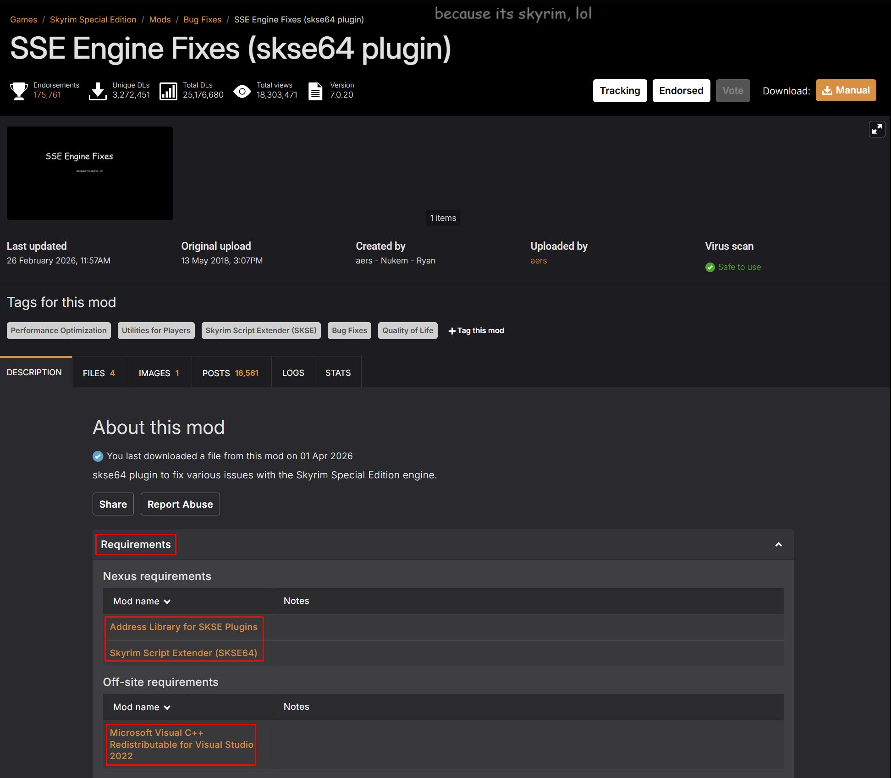
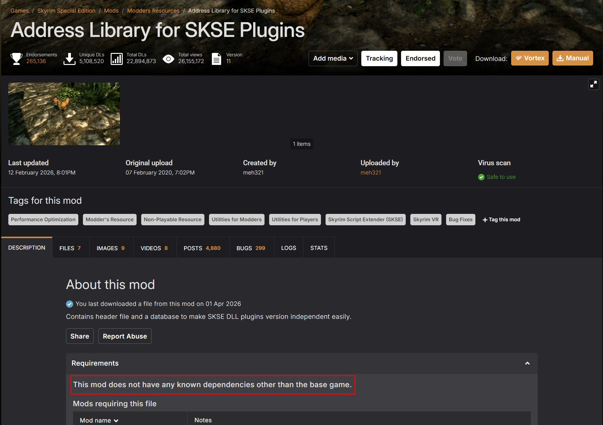
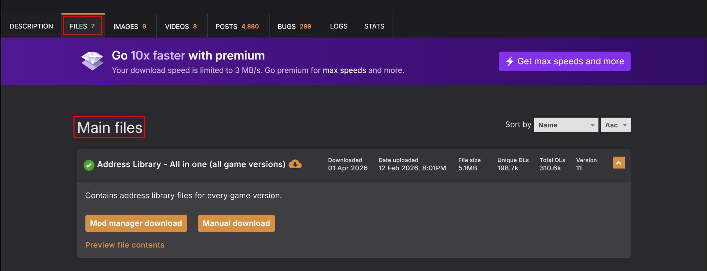
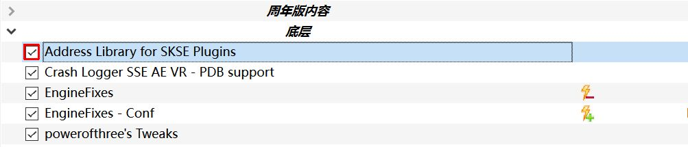
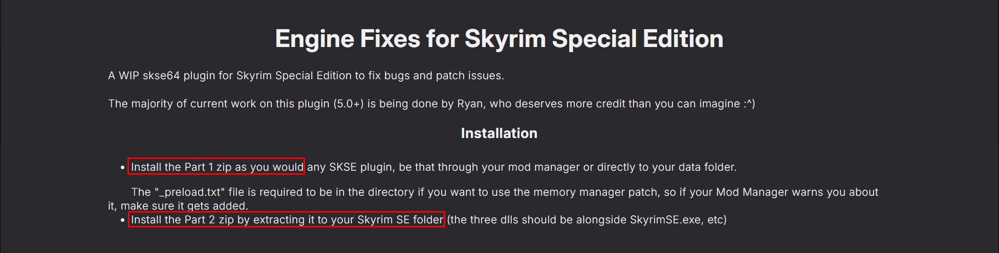
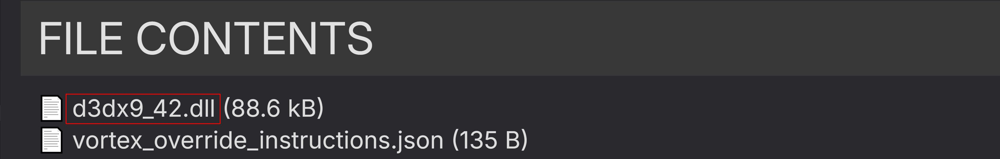
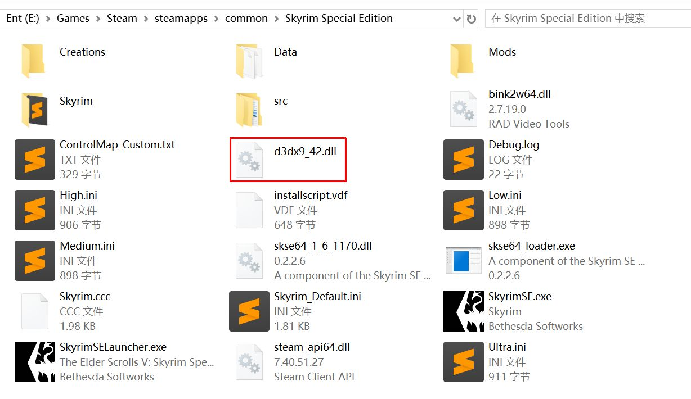

天际在使用 Mod 后默认情况下会禁用成就功能，可以通过安装启用成就的 Mod 来恢复成就功能。

## SSE Engine Fixes

> SSE Engine Fixes 是一个修复游戏引擎 Bug 的 Mod，其中包含了启用成就的功能。

在 Mod [主页](https://www.nexusmods.com/skyrimspecialedition/mods/17230?tab=description)查看 Mod 依赖，
发现该 Mod 需要 Address Library for SKSE Plugins、 SKSE 以及 MSVCR 作为依赖。

SKSE 与 MSVCR 此前已经安装，因此接下来首先安装 Address Library for SKSE Plugins。

点击 Nexus Requirements 中的 Address Library for SKSE Plugins 即可进入 Address Library for SKSE Plugins Mod 页面。

查看发现该 Mod 并无任何依赖。

直接点击 Files 标签页，下载唯一的 Main File 即可。

点击 Manual download 手动下载。

或使用 Mod manager download 直接通过 MO2 下载（需要[在 MO2 中关联 NXM 链接](/skyrimse-modding-guide/faq/mo2-link-nxm)）。

将下载后的文件拖动到 MO2 左侧面板即可安装。安装后勾选 Mod 前面的复选框以启用 Mod。

接下来安装 SSE Engine Fixes。查看 SSE Engine Fixes 的 Description，该 Mod 的安装需要一些手动操作。

因此点击进入 Files 页面，下载 Main files 中的两个文件 - Main File 以及 SKSE64 Preloader。

将 Main File 通过 MO2 直接安装。

将 SKSE64 Preloader 解压缩，得到 `d3dx9_42.dll` 以及一个无关文件，将 `d3dx9_42.dll` 文件直接移动到游戏根目录，与 `SkyrimSE.exe` 同级即可。

