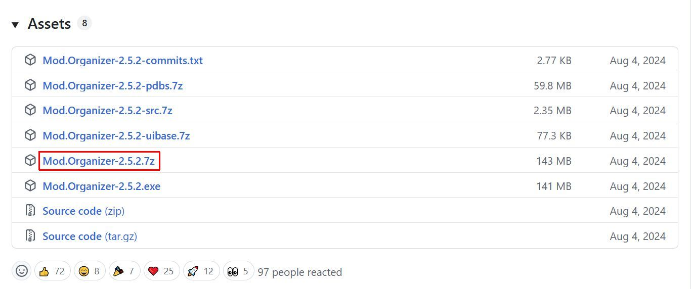
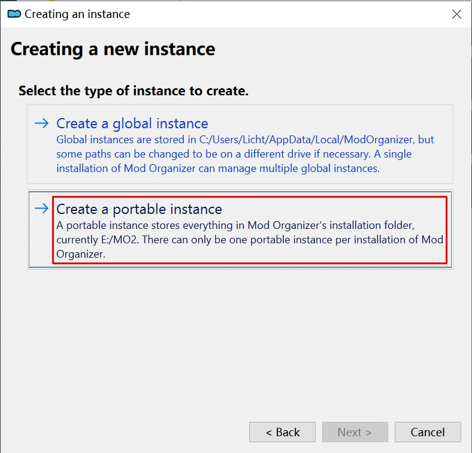
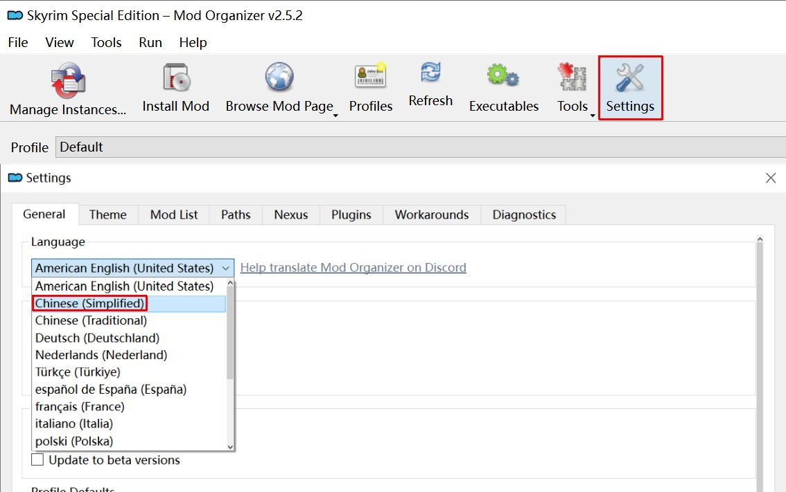
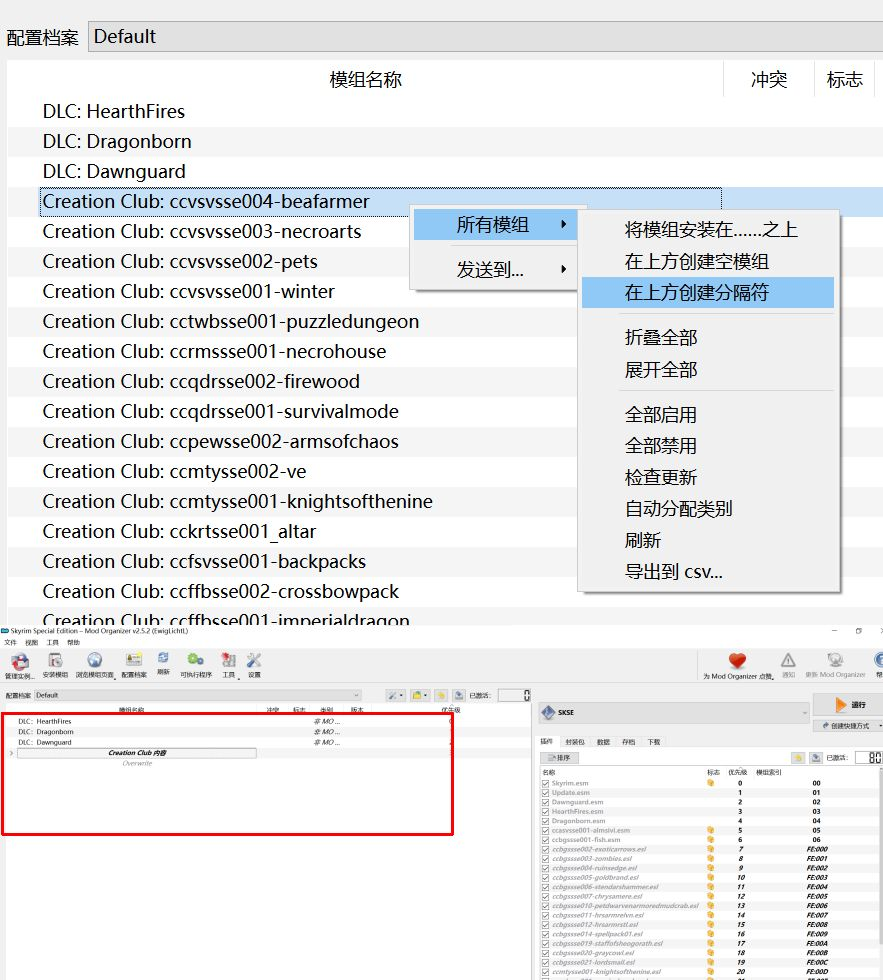
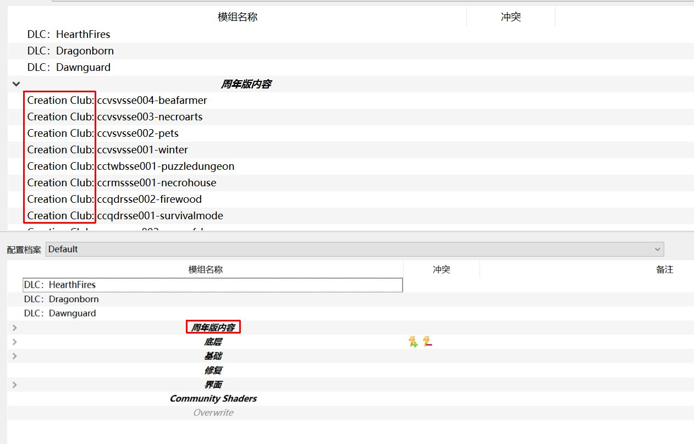
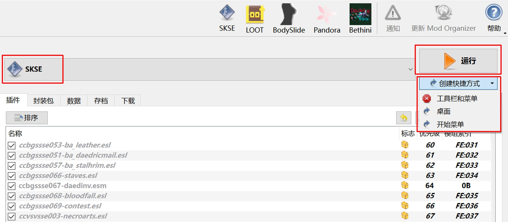

MO2 是对 **Mod Organizer** 2.0 + 版本的简称。即使只安装个位数的 Mod，也推荐使用 Mod 管理器。

## 下载安装

从 [GitHub](https://github.com/Modorganizer2/modorganizer/releases) Releases 中下载最新版本的 MO2 便携版文件 `Mod.Organizer-2.5.2.7z`。

解压缩并将解压后得到的文件放在你想存放 Mod 的位置，比如 `E:\Games\SkyrimSE\MO2`。

双击 `ModOrganizer.exe` 即可启动 MO2，你可以创建一个快捷方式放到桌面。

## 初次启动

在创建实例时选择便携式实例。

在选择游戏时选择 `Skyrim Special Edition`。

后续的步骤选择默认选项即可，直到完成配置。

## 简单设置

MO2 官方支持简体中文。

## 整理内容

创建分隔符可以折叠内容以方便管理 Mod。保持左侧边栏整洁。

在左侧面板空白处右键 → 创建分隔符，或在任意 Mod 上右键 → 所有模组 → 在上方创建分隔符。

长按并拖拽可以移动分隔符或 Mod 位置，将 Mod 拖到分隔符以下即可将 Mod 放入分组中，并可使用左侧箭头进行折叠。

:::tip
建议保持良好的 Mod 分类整理习惯，否则随着 Mod 数量越来越多，管理起来会越发麻烦。
:::

例如将所有周年 DLC （Creation Club）内容放在同一分组下。

## 运行游戏

:::tip
在使用 MO2 管理 Mod 之后，每一次启动游戏都需要使用 MO2 中的 SKSE 来启动游戏。

如果你好奇为什么要这么做，可以参考[为什么需要 MO2](/skyrimse-modding-guide/faq/why-mo2/)。
:::

MO2 会自动检测到游戏路径并在可执行程序中添加 SKSE 的启动项，选择 SKSE 运行以启动游戏。

你可以将快捷方式添加到桌面或开始菜单，以方便启动游戏。

