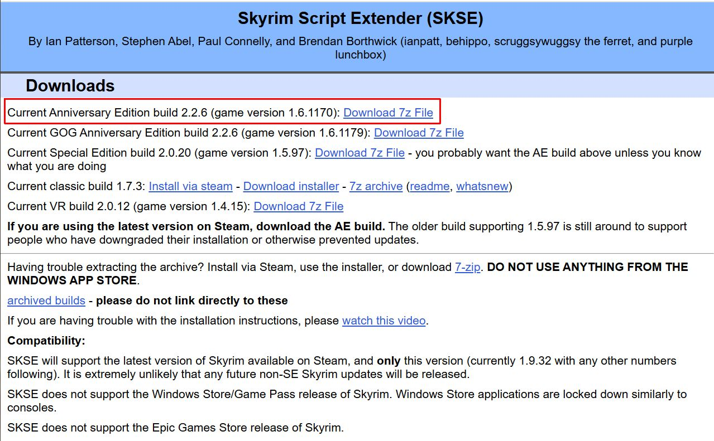
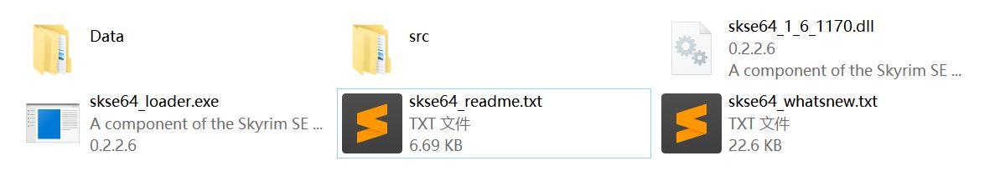
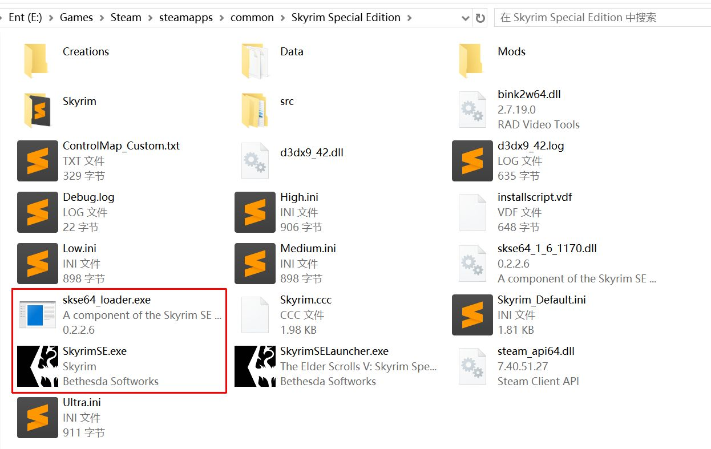
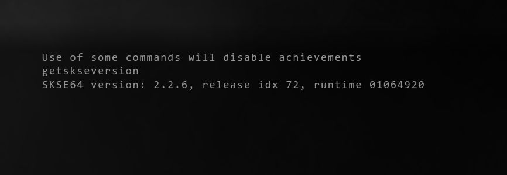

SKSE 全称为 Skyrim Script Extender，是上古卷轴 5 Mod 基础中的基础，没有 SKSE 就无法使用大部分 Mod。

:::tip
安装 SKSE 后，以后启动游戏都需要通过 SKSE 启动，而不是通过 Steam。
:::

## 下载安装

打开[官方网站](https://skse.silverlock.org/)，点击顶部 `Download 7z File`下载文件。

下载完成后，使用 7-Zip 解压缩得到下列文件。

将解压缩后的文件全部移动到游戏根目录，`skse64_loader.exe` 与 `SkyrimSE.exe` 同目录即可，效果如下。

## 验证安装

**双击 `skse64_loader.exe` 运行游戏**。进入游戏主界面后，按下键盘左上角的 `~` 键，
输入 `getskseversion` 并回车。

如果正确安装，会显示当前 SKSE 版本。游戏版本 `1.7.99` 对应的 SKSE 版本为 `2.3.0`。

