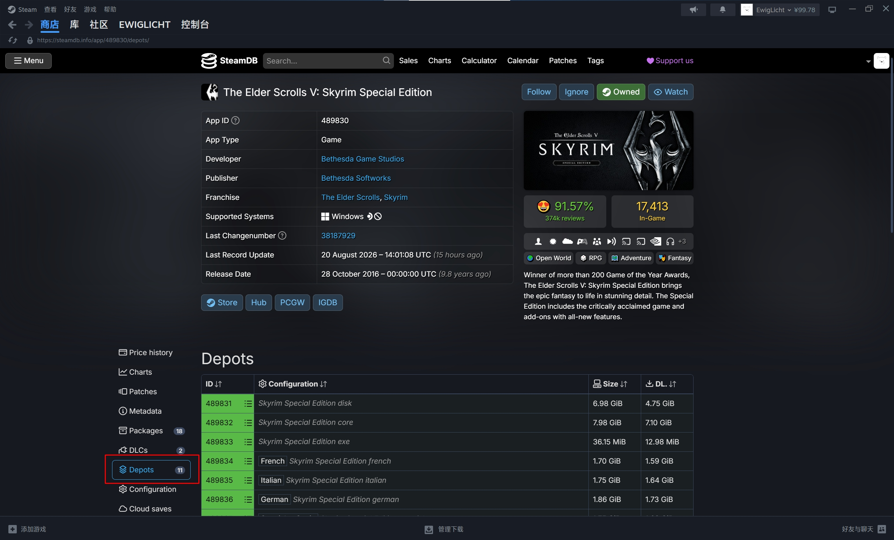
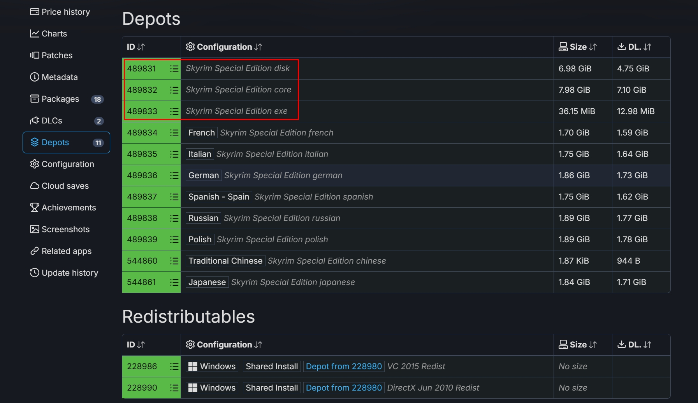
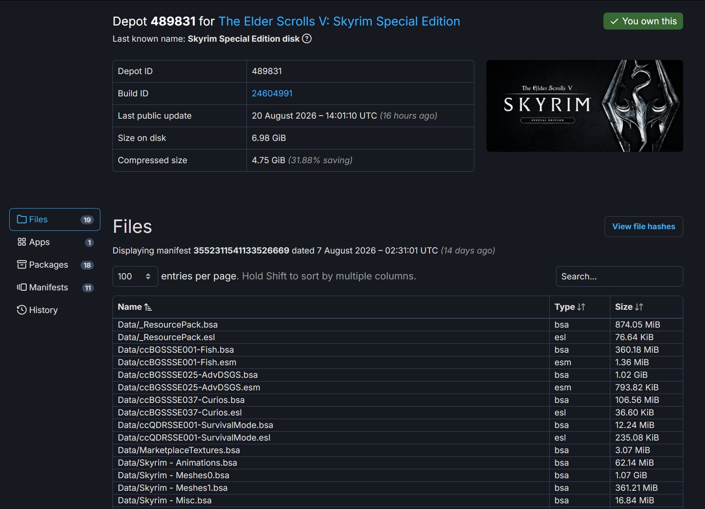
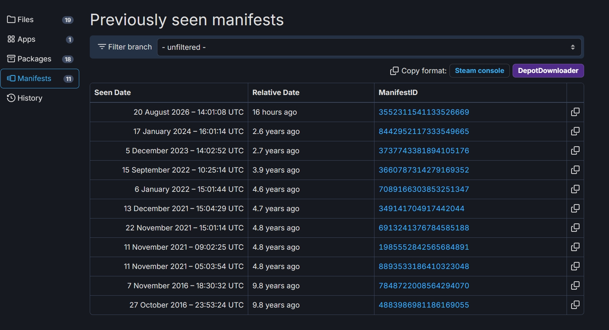
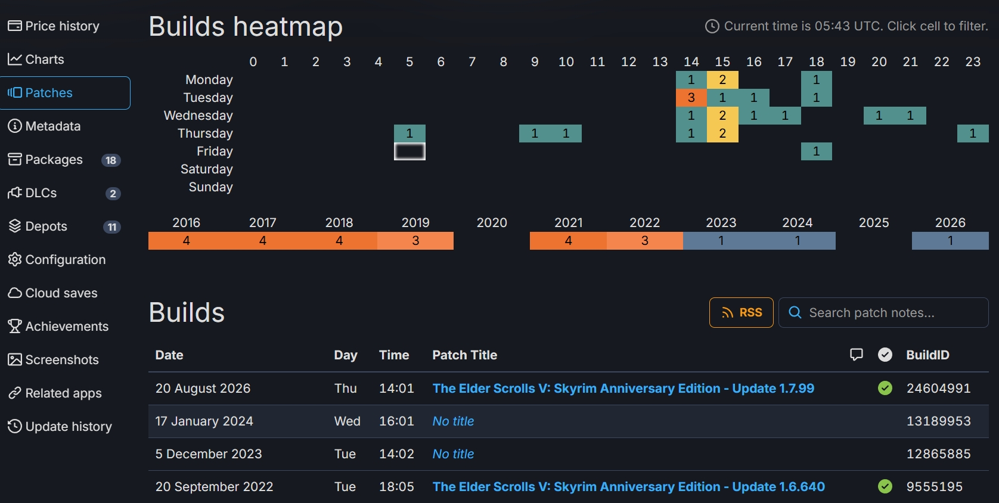
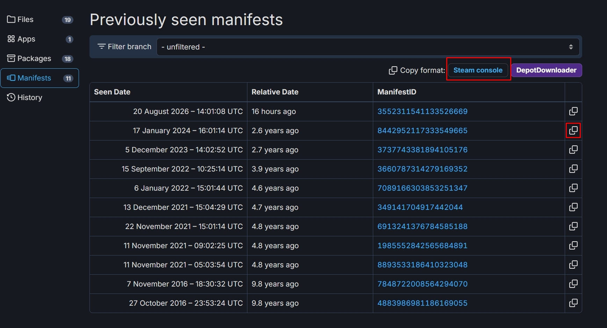
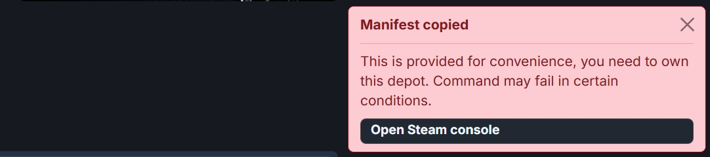
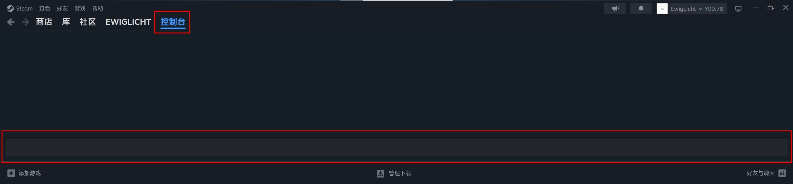

以防万一你可能故意不小心更新了游戏，而 Mod 暂未更新导致无法进入游戏。

你可以利用 Steam 自身的功能降级游戏。

:::tip
该方法适用于所有 Steam 游戏。该方法同样可用于单独下载游戏可下载内容。
:::

## 获取游戏版本信息

访问该游戏的 [SteamDB 页面](https://steamdb.info/app/489830/depots/)，点击 `Depots` 获取 Depots 信息。



以《上古卷轴5：天际 特别版》为例，该游戏主要文件 depots 为 `489831`、`489832`、`489833` 。

也就是说下载这三个 depots 即可以得到完整的游戏文件。



点击 depots `ID` 查看详情，可以看到 depots 中对应的游戏文件。



点击 `Manifests` 即可查看该 depots 历史更新记录。



根据历史更新记录可以判断游戏版本，例如上图中第二个清单 ID 对应的游戏版本为 `1.6.1170`，倒数第二个 ID 对应的游戏版本为 `1.5.97`。
更新记录可以在 `Patches` 中查看。



确定 Depots 以及对应版本的 Manifest ID 之后，将复制格式改为 `Steam Console`。



点击复制后，网页右上角会提示必须拥有游戏才可以下载，根据提示点击打开 Steam 控制台。



该操作会打开 Steam 客户端，开启控制台，并复制好下载命令。
将下载命令粘贴到命令输入框中，按下回车，即可开始下载游戏文件。




重复以上步骤下载 3 个 depots 以及对应版本的文件。

---

写到一半临时有事，待更新

<!-- ## 开启 Steam 控制台

按下键盘上的 `Win` + `R` 键调出 Windows 运行窗口，输入

```
steam://open/console
```
按下回车，会自动打开 Steam 控制台。在下方可以输入命令。

 -->