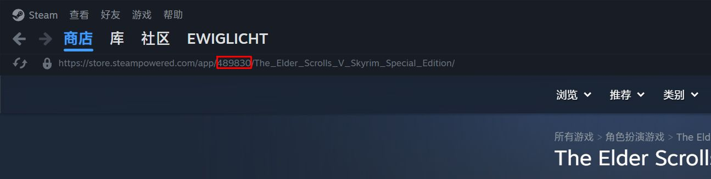
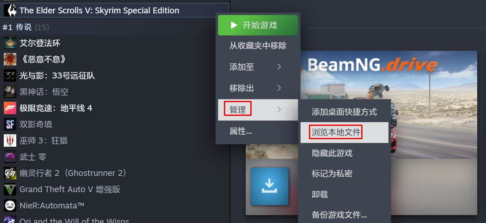
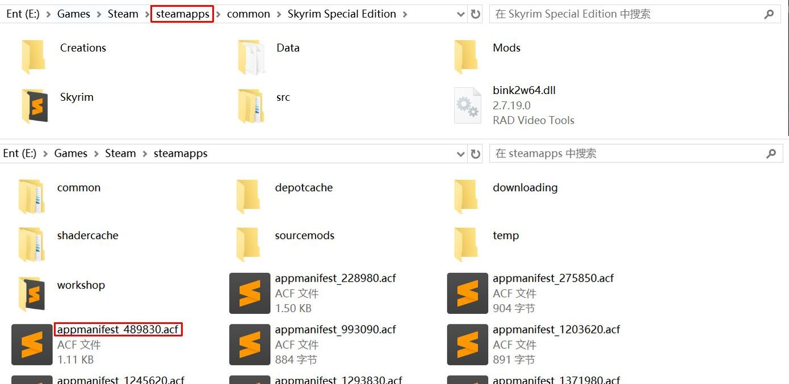
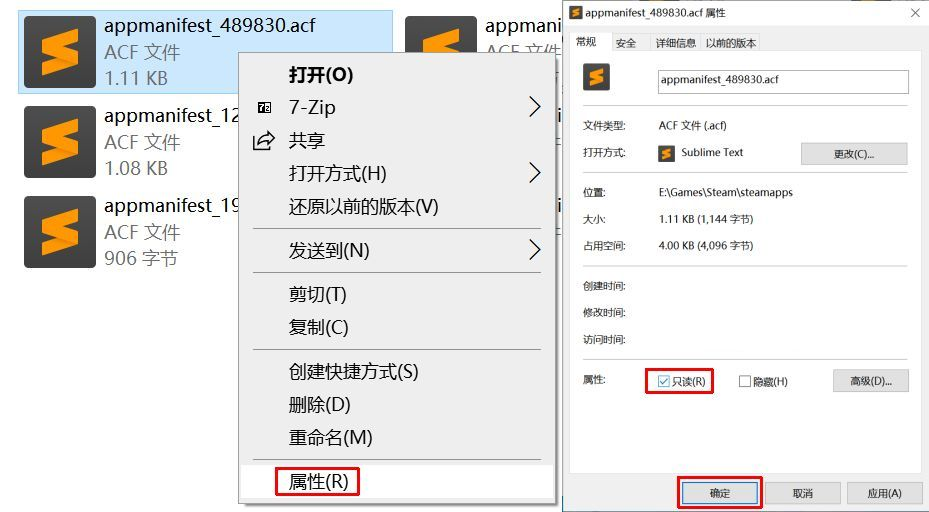

更新游戏可能会导致 Mod 失效。

虽然天际重制版发布已近十年，且很长一段时间没有更新，
但为了以防万一，你可以选择阻止 Steam 自动更新游戏。

:::tip
该方法适用于所有 Steam 游戏。
:::

## 获取游戏 App ID

打开游戏 Steam 商店页面，URL 中 `app/` 后的数字即为该游戏 App ID。

天际重制版的游戏 ID 为 `489830`.

## 锁定更新

在库中的 The Elder Scrolls V: Skyrim Special Edition 上右键，管理，浏览本地文件，随后会打开游戏目录。

前往上上层目录 `steamapps`，找到 `appmanifest_489830.acf` 文件。

右键，属性，勾选只读，确定。

完成后，Steam 将无法修改此文件，因此也无法更新该游戏。

如需恢复更新按照相同步骤取消勾选`只读`即可。
