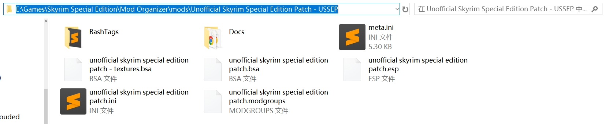
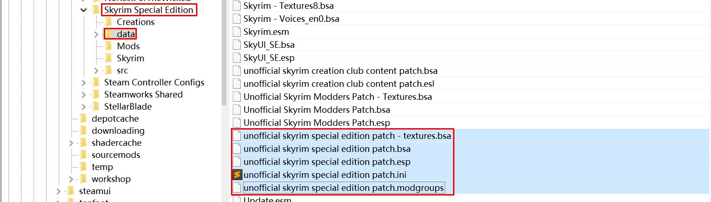
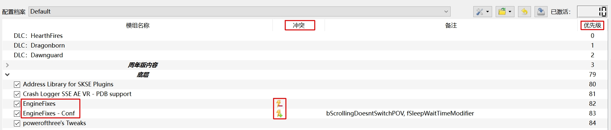

MO2 全称 Mod Organizer 2，是一款功能强大的模组管理工具，具有用户友好的界面，使玩家能够轻松地安装、管理和组织 Mod。

MO2 的主要优势在于它的虚拟文件系统，借助该系统可以在不修改原始游戏文件的情况下安装和测试模组，从而避免潜在的冲突和问题。

## 虚拟文件系统

虚拟文件系统正如其名。 MO2 不会修改任何游戏目录下的文件，而是将 Mod 安装在一个独立的目录中，当你启动游戏时，MO2 会将这些 Mod 虚拟的加载到游戏进程中。

:::tip
也正因为如此，如果你不使用 MO2，直接通过 Steam 启动游戏时运行的将会是纯净的“原版”游戏。
:::

任何通过 MO2 安装的 Mod 都会出现在左侧 Mod 列表中，此时选中该 Mod 右键，选择“在资源管理器中打开”，你会发现该 Mod 的文件并不在游戏目录下，而是在 MO2 的安装目录中。

而当你启动游戏时，MO2 会创建一个虚拟的文件系统，这样你的游戏就会以为这些 Mod 文件已经安装在游戏目录中。

## 解决文件冲突

同样得益于虚拟文件系统，处理不同 Mod 之间的文件冲突，管理 Mod 配置等也更简单。

MO2 中的每个 Mod 都有其优先级，数字越大，优先级越高。
对于 Mod 之间的冲突，MO2 提供了直观的标志以提醒用户。

例如下图中的 EngineFixes 与 EngineFixes - Conf，
它们都修改了游戏中的同一个文件 `EngineFixes.toml`，
由于 EngineFixes - Conf 的优先级较高，
那么在启动游戏时，MO2 只会加载 EngineFixes - Conf 中的 `EngineFixes.toml` 文件，

## 整理 Mod

MO2 提供了直观的方式用来整理 Mod，拖动 Mod 即可排序，创建分隔符可以对 Mod 进行分组，使用每一个 Mod 左侧的复选框可以快速启用/禁用 Mod 等。

