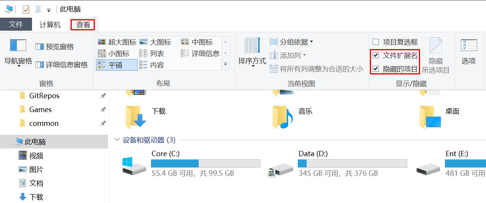

在正式开始给游戏安装 Mod 前，需要先做一些准备工作。

**如果你选择继续阅读，那么:**

- 如果不清楚文件扩展名是什么、不会正确安装卸载程序、不了解如何处理不同格式的压缩文档，那么本指南对你来说会难以理解。
- 天际的主要 Mod 来源 NexusMods 网站可以直接连接，但仍推荐你在有国际互联网访问权限的情况下继续，否则本指南中的一些步骤对你来说会难以完成。
- 天际的 Mod 安装是一个占用大量时间并不断学习的过程，需要面对 Mod 之间的依赖、排序、冲突、配置、兼容性等问题。
- 一定的英文阅读理解能力可以在很大程度上帮到你。或者你可以借助可靠的翻译工具。
- 指南中的步骤并不是唯一方案，你可以触类旁通。

## Windows 系统与程序

本指南使用 **Mod Organizer** 作为 Mod 管理器，需要 **Windows 10 1809** 或更高版本系统，以及 **Microsoft Visual C++ Redistributable 14.40.33810.0** 或更高版本程序。

点击[最新受支持 x64 版本的永久链接](https://aka.ms/vc14/vc_redist.x64.exe)下载最新版本 MSVCR 安装程序并安装。

:::tip
安装完成后建议重启系统一次以确保生效。
:::

## 文件资源管理器

确保文件资源管理器：

✅ 已显示**文件扩展名**

✅ 已显示**隐藏的项目**

可以在 **文件资源管理器 → 查看 → 显示/隐藏** 中进行确认:

## 压缩文档管理

建议安装 [7-Zip](https://www.7-zip.org/)，以便处理压缩文档。

## 其他

- 【使用鼠标中键（滚轮）】或【按住键盘上的 `Ctrl` 键并使用鼠标左键点击】网页中的链接可以快速在新标签页打开页面。